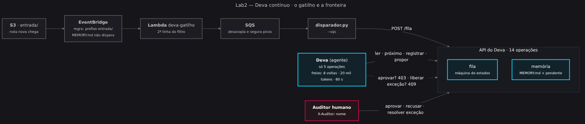

# Lab2 — Deva contínuo: agente com gatilho, fila e memória revisável

O Deva3 (pasta [`../Lab`](../Lab/)) respondia quando alguém chamava. O **Deva do Lab2 trabalha
sozinho**: uma nota de despesa cai no S3, um gatilho acorda o agente, ele confere, registra e,
quando fica em dúvida, **propõe** uma regra nova. Nenhuma regra entra na memória sem a assinatura
de um auditor humano.

A pergunta da aula não é "o agente acerta?". É esta: **o que impede o agente de fazer o que não
deve, mesmo quando o prompt falha?** A resposta do Lab2 é a **fronteira em código**:

| Camada | O que garante | Onde está |
|---|---|---|
| Especificação do agente | O agente só **enxerga** 5 das 14 operações. Aprovar não existe para ele. | `agente/openapi-agente.json` |
| Cabeçalho `X-Auditor` | Aprovar memória ou resolver exceção exige um nome humano. Sem nome ou com "deva" → **403**. | `api/servicos/memoria.py` |
| Máquina de estados | Item em `excecao` não volta para o agente → **409**. | `api/servicos/fila.py` |
| Filtros da proposta | Texto que parece instrução vira **incidente** (422); mexer na alçada vai para a controladoria (422); teto de 50 pendentes (429). | `api/servicos/memoria.py` |
| Freios do laço | 8 voltas · 20 mil tokens · 60 s por execução. | `gatilho/ciclo_do_agente.py` |
| Gatilho | Só o prefixo `entrada/` dispara. Gravar o MEMORY.md no bucket **não** acorda o agente. | regra do EventBridge + `lambda_gatilho.py` |



## Estrutura

```
Lab2/
├── AGENTS.md                 o "contrato" do agente (v2.0, 11 seções)
├── MEMORY.md                 semente da memória: parâmetros e regras ASSINADAS
├── agente/openapi-agente.json  as 5 operações que o agente recebe (as descrições são prompt)
├── api/                      FastAPI com 14 operações (docs em /docs)
│   ├── servicos/             memória, fila (máquina de estados), armazenamento
│   └── testes/               22 testes, sem rede e sem AWS
├── gatilho/
│   ├── amostras/             3 notas: normal, reenvio idêntico, nota com injeção
│   ├── disparador.py         --semear | --s3 BUCKET | --sqs URL
│   ├── lambda_gatilho.py     EventBridge → SQS
│   └── ciclo_do_agente.py    uma volta do agente (sem LLM ou com Bedrock) + demos
├── web/aplicacao.py          mesa do auditor (Streamlit): Painel, Memória, Propostas, Exceções
├── infra/terraform/          bucket, regra, Lambda (LabRole), SQS
├── docs/                     diagramas (Mermaid + PNG) e o guia do Kiro
└── kiro-referencia/          steering, spec e hook de referência para o hands-on do Kiro
```

## Começo rápido (sua máquina, sem AWS)

```bash
make instalar
make testar                 # 22 testes verdes
make api                    # terminal 1 → http://localhost:8000/docs
make web                    # terminal 2 → mesa do auditor
make semear && make volta   # terminal 3; rode `make volta` 4 vezes
make demos                  # 403, 409, 422: a fronteira em ação
```

O passo a passo completo, com o caminho pelo CloudShell e o gatilho na AWS, está no
[guia-lab.md](guia-lab.md).

## Dois cérebros, a mesma fronteira

`ciclo_do_agente.py --uma-volta` usa um **cérebro sem LLM** (regras em Python, ordem da
[árvore de decisão](docs/imagens/02-arvore-decisao.png)). É o que roda no Learner Lab, que não
libera o Bedrock, e é o que os testes cobrem.

`--uma-volta --bedrock` troca o cérebro por um modelo no Bedrock via **API Converse**: as 5
operações da OpenAPI viram `toolSpec`, e o laço respeita os três freios. Escolha o modelo com
`BEDROCK_MODEL_ID` (padrão: Claude Haiku 5.5 no perfil `global.`). **A API e a fronteira são as
mesmas** — é exatamente esse o ponto: trocar o modelo não pode mudar o que o agente consegue fazer.

> No Learner Lab, o modo `--bedrock` é **demonstração do professor** numa conta comum.

## Limpeza

```bash
make limpar                 # terraform destroy
```
